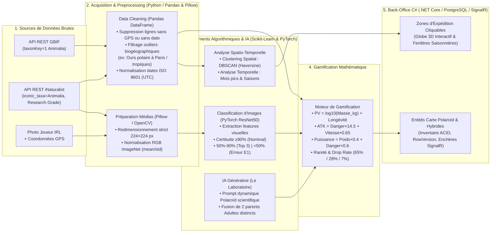

# BIOMA — SAE S5.A.01 (Collection Scientifique & Biodiversité par IA)

Application complète de collection de cartes Polaroïd d'espèces réelles (**GBIF** & **iNaturalist**) développée selon l'architecture tri-applicative exigée :
1. **Back-Office C# (.NET 9 / ASP.NET Core / EF Core / SignalR)** : `backend-csharp/` — Logique métier, persistance relationnelle PostgreSQL (UUID `Guid`, `DateTimeOffset`, verrouillage optimiste `RowVersion`), Marché aux Enchères temps réel via WebSockets (`SignalR`), Quiz chronométré côté serveur (10s) et Batailles 1v1 scientifiques.
2. **Back-Office Python (FastAPI / Pandas / Scikit-Learn DBSCAN / PyTorch)** : `backend-python/` — Pipeline d'acquisition et nettoyage des données scientifiques, clustering spatial DBSCAN pour le Globe 3D, reconnaissance d'images (Capture IRL) et fusion générative au Laboratoire.
3. **Frontend Blazor (.NET 9 Interactive Razor Components)** : `frontend-blazor/Bioma.Client/` — Interface fidèle aux maquettes **Figma** du Cahier des Charges (Refuge, Tirages *Échos du vivant*, Vitrines 3D *Mes biomes*, Collection & Progression XP, Quiz Chronométré, Globe 3D d'Expéditions, Laboratoire IA et Marché aux Enchères).

---

## 1. Schéma Global du Pipeline Data Processing & Analyse (Python $\rightarrow$ C#)

> **Schéma d'architecture du flux de données** : de la donnée brute (API REST GBIF / iNaturalist & Photo Joueur) jusqu'à l'instanciation en « Carte Animal » ou « Zone d'Expédition » dans le moteur C#.



---

## 2. Détail des 4 Étapes du Back-Office Python (`backend-python`)

### Étape 1 : Acquisition et Nettoyage (`app/services/preprocessing.py`)
- **Récupération des données** : Requêtes REST vers **GBIF** (`taxonKey=1`) et **iNaturalist** (`iconic_taxa=Animalia`, `quality_grade=research`) au standard international *Darwin Core*.
- **Nettoyage Pandas (`clean_observations_dataframe`)** :
  1. Suppression des enregistrements dépourvus de coordonnées GPS (`latitude`, `longitude`) ou de date valide.
  2. Détection et élimination des observations aberrantes (*Outliers biogéographiques* : ex. un Ours polaire `Ursus maritimus` signalé à Paris `48.85°N` ou sous les tropiques est automatiquement écarté).
  3. Uniformisation des dates au format **ISO 8601 UTC** (`YYYY-MM-DDTHH:MM:SSZ`) et extraction du mois d'observation (`1..12`).
- **Préparation des images (`preprocess_image_for_neural_net`)** : Redimensionnement strict en `224×224` pixels et normalisation des canaux RGB selon les constantes ImageNet (`mean=[0.485, 0.456, 0.406]`, `std=[0.229, 0.224, 0.225]`).

### Étape 2 : Analyse Spatio-Temporelle — Le Moteur des Expéditions (`app/services/clustering.py`)
- **Clustering Spatial (`DBSCAN` / Scikit-Learn)** : Convertit les milliers de points GPS en radians et applique `DBSCAN(eps=eps_rad, min_samples=3, metric='haversine')` pour regrouper les observations en **zones de forte densité (Hotspots)** tout en éliminant le bruit isolé (`label = -1`). Ces clusters deviennent les destinations cliquables sur le Globe 3D.
- **Analyse Temporelle (Saisonnalité)** : Analyse la distribution fréquentielle du mois d'observation dans chaque cluster pour déterminer la saison optimale (*Printemps*, *Été*, *Automne*, *Hiver*) et l'ouverture de la fenêtre d'expédition.

### Étape 3 : Traitement par Intelligence Artificielle (`app/services/vision_fusion.py`)
- **La Capture IRL (`identify_captured_animal` - Fiche Use Case 1)** :
  - `Confiance >= 90%` : Scénario nominal $\rightarrow$ déblocage immédiat du Polaroïd (ou conversion en monnaie/XP si doublon, scénario 7a).
  - `50% <= Confiance < 90%` : Scénario alternatif 4a $\rightarrow$ propose les 3 espèces les plus probables au joueur.
  - `Confiance < 50%` : Exception E1 $\rightarrow$ *"Sujet non reconnu, rapprochez-vous ou améliorez l'éclairage"*.
- **Le Laboratoire de Fusion (`fuse_animals` - Fiche Use Case 2)** :
  - Vérifie que les deux parents sont au stade `Adulte` et d'espèces distinctes (bloque l'auto-fusion — Exception E2).
  - Génère un prompt dynamique (`"A realistic polaroid photo of a hybrid creature combining..."`) et pondère les statistiques :
    $$\text{Stat}_{\text{Hybride}} = \frac{\text{Stat}_A + \text{Stat}_B}{2} \times \text{Multiplicateur}_{\text{Rareté}} \times \begin{cases} 1.10 & \text{si Catalyseur Boost} \\ 1.00 & \text{sinon} \end{cases}$$

### Étape 4 : Transformation en Données de Jeu — Gamification (`app/services/gamification.py`)
- **Points de Vie (PV)** : Compression logarithmique de la masse réelle et longévité :
  $$\text{PV} = \text{round}\left(45 + 38 \log_{10}(10 \cdot \text{Poids}_{\text{kg}} + 1) + 1.8 \cdot \text{Longévité}_{\text{ans}}\right) \in [40, 320]$$
- **Attaque (ATK)** : Basée sur l'indice de dangerosité scientifique $[1..10]$ et la vitesse de pointe $(\text{km/h})$ :
  $$\text{ATK} = \text{round}\left(15 + 14.5 \cdot \text{Danger} + 0.65 \cdot \text{Vitesse}_{\text{km/h}}\right) \in [20, 250]$$
- **Puissance de Combat 1v1 (Diagramme de séquence p.7)** :
  $$\text{Puissance} = \text{Poids}_{\text{Score}} \times 0.4 + \text{Danger}_{\text{Score}} \times 0.6 + \text{Bonus}_{\text{Biome}}$$

---

## 3. Structure du Dépôt (`w:\bioma`)

```text
w:\bioma
├── Bioma.sln                                  # Solution .NET 9 regroupant Backend C#, Tests et Frontend Blazor
├── docker-compose.yml                         # Orchestration PostgreSQL + Python FastAPI + C# API + Blazor UI
├── backend-csharp/
│   ├── Dockerfile
│   ├── Bioma.Domain/Entities/DomainEntities.cs       # Entités UUID (Guid), DateTimeOffset, RowVersion
│   ├── Bioma.Application/DTOs/GameDtos.cs            # Contrats DTO inter-couches
│   ├── Bioma.Application/Interfaces/IBiomaServices.cs
│   ├── Bioma.Infrastructure/Data/BiomaDbContext.cs   # EF Core PostgreSQL / InMemory
│   ├── Bioma.Infrastructure/Data/BiomaDbSeeder.cs    # Seed fidèle aux maquettes Figma (Camille, 1240 feuilles, etc.)
│   ├── Bioma.Infrastructure/Services/PythonAiClient.cs
│   ├── Bioma.Infrastructure/Services/BiomaGameService.cs
│   ├── Bioma.Api/Controllers/BiomaControllers.cs     # Endpoints REST (Profile, Capture, Lab, Quiz, Combat, Auctions)
│   ├── Bioma.Api/Hubs/AuctionHub.cs                  # Hub WebSockets SignalR temps réel
│   └── Bioma.Tests/BiomaGameServiceTests.cs          # Tests unitaires et d'intégration xUnit
├── backend-python/
│   ├── Dockerfile
│   ├── requirements.txt
│   ├── app/main.py                                   # Application FastAPI
│   ├── app/models/schemas.py                         # Schémas Pydantic
│   ├── app/services/preprocessing.py                 # Étape 1 : GBIF/iNaturalist, Pandas Cleaning & Image 224x224
│   ├── app/services/clustering.py                    # Étape 2 : Scikit-Learn DBSCAN & Saisonnalité
│   ├── app/services/vision_fusion.py                 # Étape 3 : PyTorch Vision & Fusion Générative
│   ├── app/services/gamification.py                  # Étape 4 : Formules mathématiques de gamification
│   ├── app/routers/expeditions.py
│   ├── app/routers/lab.py
│   └── tests/test_pipeline.py                        # Tests unitaires Pytest du pipeline Python
└── frontend-blazor/
    ├── Dockerfile
    └── Bioma.Client/
        ├── wwwroot/css/bioma.css                     # Design System Figma (Vert forêt profond, crème, Polaroïd)
        ├── Shared/MainLayout.razor                   # Barre de navigation Figma
        ├── Shared/PolaroidCard.razor                 # Composant Carte Polaroïd réutilisable
        └── Pages/
            ├── Refuge.razor                          # Page principale : Votre refuge, Pack & Biome actif
            ├── Tirages.razor                         # Page tirage : Échos du vivant (65% / 28% / 7%)
            ├── Biomes.razor                          # Page de biome : La Clairière, Les Dunes, Les Berges (Vitrine 3D)
            ├── Collection.razor                      # Page de collection : Filtres, XP, Soins & Évolution
            ├── Quiz.razor                            # Page de quiz : Chronomètre strict 10s
            ├── Expeditions.razor                     # Page d'expédition : Globe 3D & Hotspots DBSCAN
            ├── Auctions.razor                        # Page d'achat/vente : Marché aux enchères SignalR
            └── Laboratoire.razor                     # Page Laboratoire IA, Capture IRL & Batailles 1v1
```

---

## 4. Démarrage Rapide

### Lancer l'interface Blazor (avec données Figma pré-chargées)
```powershell
dotnet run --project w:\bioma\frontend-blazor\Bioma.Client\Bioma.Client.csproj --urls "http://localhost:5000"
```

### Lancer le Back-Office C# (.NET API + SignalR)
```powershell
dotnet run --project w:\bioma\backend-csharp\Bioma.Api\Bioma.Api.csproj --urls "http://localhost:5080"
```

### Lancer le Back-Office Python (FastAPI Data & AI)
```powershell
cd w:\bioma\backend-python
pip install -r requirements.txt
uvicorn app.main:app --reload --port 8000
```

### Exécuter les Tests Unitaires (.NET xUnit)
```powershell
dotnet test w:\bioma\Bioma.sln
```
